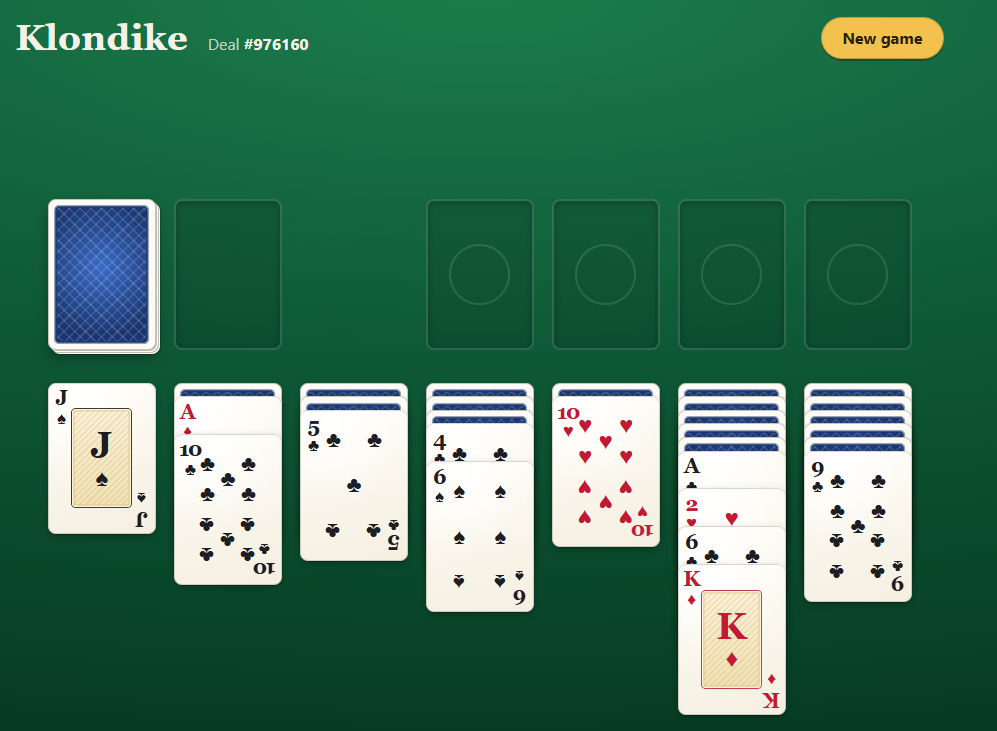

# Solitaire

An unfinished Klondike table in React and TypeScript. It deals a game and lets you move
cards around, but it doesn't know the rules yet. What it shows is the plumbing: a seeded
shuffle, reducer-driven state shared through context, and drag and drop written directly
against Pointer Events.



## What you're looking at

The screenshot is deal **#976160** a few moves in.

- **Top left** is the stock, still face down, and next to it the waste, empty because no card
  has been drawn yet. Clicking the stock turns its top card onto the waste.
- **Top right** are the four foundations, the empty slots marked with circles. Any card can be
  dropped on them.
- **Below** are the seven tableau piles. The blue backs are face-down cards, and the face-up
  card at the front of each pile is the one you pick up. Anything stacked on top of it comes
  along when you drag.
- **The moves already made show what's missing.** In the second pile the 10♣ sits on the A♦,
  and the sixth pile runs A♣, 2♥, 6♣, K♦. Real Klondike allows neither. Here any card can go on
  any pile, because the rules aren't written yet.
- **The deal number** in the header is also in the address bar. Opening `?deal=976160` deals
  the same starting table again, and **New game** shuffles a fresh one.

The app itself shows a "Work in progress" banner under the header saying the same thing.

## What it does

- Deals from a numbered, reproducible shuffle (Fisher-Yates over mulberry32).
- Clicking the stock turns a card onto the waste; an empty stock turns the waste back over.
- Any face-up card, with the cards on top of it, can be dragged onto any other pile by
  mouse, pen or touch. Uncovered face-down cards turn over.
- Without dragging: click (or press Enter on) a card, then the pile it should go to.
  Escape cancels, and moves are announced to screen readers.
- Cards are drawn with CSS and Unicode suit symbols; the app uses no image assets.

Not done yet: move rules, scoring, win detection and undo.

## Running it

Needs Node 24 or later.

```sh
npm ci
npm run dev       # http://localhost:5173
npm run check     # typecheck, lint, then tests with coverage (100% thresholds)
```

## Containers

`compose.yaml` serves the build from unprivileged nginx (read-only filesystem, strict CSP)
behind Traefik. A one-off `certificates` service creates a local CA and a wildcard
certificate for `*.showcases.chipomho.local`.

```sh
docker compose up --build -d
curl --cacert .certs/ca.crt --resolve solitaire.showcases.chipomho.local:443:127.0.0.1 \
  https://solitaire.showcases.chipomho.local/
```

To use a browser, map `solitaire.showcases.chipomho.local` to 127.0.0.1 in your hosts file
and trust `.certs/ca.crt`. `SHOWCASES_HTTP_PORT` and `SHOWCASES_HTTPS_PORT` move Traefik off
80 and 443, and the HTTP redirect follows. `SHOWCASES_CA_DIR` shares one CA between
projects; create that directory first, because Podman won't create a missing bind mount.
With Podman, build with `DOCKER_BUILDKIT=0 COMPOSE_BAKE=false` so it uses its own builder.

## How it's put together

- `src/game` is plain TypeScript: cards, the PRNG and shuffle, the deal, and the reducer.
  Piles are arrays from bottom to top, keyed by ids like `tableau-3`. The reducer has four
  actions (`newGame`, `draw`, `recycleWaste`, `moveCards`) and deliberately no rules; it
  only refuses nonsense such as moving a face-down card.
- `src/state` holds `GameProvider`: one `useReducer`, with state and dispatch in separate
  contexts.
- `src/table` has the components and `useCardDrag`, a small idle/pressed/dragging state
  machine. The pressed card captures the pointer, so moves and the release come back to it
  for any pointer type. After 4px of travel it becomes a drag. A preview with
  `pointer-events: none` follows the pointer while the originals turn transparent, and the
  drop target is the nearest `data-drop-target` above `document.elementFromPoint`.

Tests use Testing Library and user-event, including mouse and multi-touch pointer
sequences. jsdom has no layout, so tests stub `elementFromPoint` to say what's under the
pointer.
